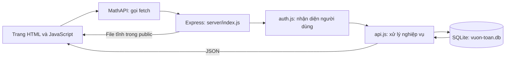

# Giải thích source code Vườn Toán Lớp 3

Tài liệu giúp người mới đọc hiểu cấu trúc dự án, trách nhiệm của từng file và cách dữ liệu đi từ giao diện đến cơ sở dữ liệu. Nội dung được đối chiếu trực tiếp với source code trong thư mục `ktpmud-bkt-vuontoan-starter`, ngày 10/11/2026.

## 1. Dự án làm gì?

Vườn Toán Lớp 3 là website học toán có hai vai trò chính:

- **Học sinh:** đăng nhập, xem bài học, làm bài tập và kiểm tra, chơi trò chơi toán học, nhận sao và xem xếp hạng trong lớp.
- **Giáo viên:** quản lý tài khoản học sinh, bài học, bộ câu hỏi, giao bài cho lớp, xem thống kê và xuất báo cáo CSV.

Ứng dụng gồm nhiều trang HTML riêng. JavaScript trên mỗi trang gọi API để lấy hoặc lưu dữ liệu. Chuyển trang thường được thực hiện bằng liên kết hoặc `location.href`.

| Công nghệ | Vai trò trong source code |
| --- | --- |
| HTML | Cấu trúc trang, nút, biểu mẫu, vùng hiển thị dữ liệu |
| CSS và Tailwind CSS | Màu sắc, bố cục, kiểu chữ, giao diện theo kích thước màn hình |
| JavaScript thuần | Xử lý thao tác, thay đổi DOM, gọi API, chạy trò chơi |
| Node.js và Express | Chạy máy chủ, phục vụ file tĩnh và xử lý API |
| SQLite qua `better-sqlite3` | Lưu tài khoản, câu hỏi, kết quả và tiến độ |
| `bcryptjs` | Băm mật khẩu khi lưu và kiểm tra mật khẩu khi đăng nhập |
| `crypto` của Node.js | Ký và kiểm tra token phiên đăng nhập bằng HMAC-SHA256 |

`package.json` khai báo Node.js từ phiên bản 18 trở lên; `Dockerfile` dùng image Node.js 20. Đây là cấu hình của dự án tại thời điểm đọc code.

## 2. Sơ đồ hoạt động



Ví dụ: khi học sinh nhấn nộp bài, trình duyệt gửi đáp án tới `/api/submissions`. Server đọc đáp án đúng trong SQLite, tính điểm, lưu kết quả và trả JSON. JavaScript dùng JSON đó để hiển thị thông báo cho học sinh.

## 3. Bản đồ thư mục

```text
ktpmud-bkt-vuontoan-starter/
├── package.json                   # Thư viện và lệnh chạy
├── package-lock.json              # Khóa phiên bản phụ thuộc
├── Dockerfile                     # Cấu hình đóng gói chạy bằng Docker
├── server/
│   ├── index.js                   # Điểm bắt đầu của server
│   ├── db.js                      # Mở SQLite, tạo bảng, nạp dữ liệu mẫu
│   ├── auth.js                    # Token, cookie, kiểm tra quyền
│   └── api.js                     # Các endpoint và logic nghiệp vụ
├── data/
│   ├── seed.json                  # Dữ liệu mẫu để khởi tạo DB
│   ├── curriculum.json            # Mục lục sách giáo khoa cho API
│   └── vuon-toan.db               # DB được tạo khi chạy, theo cấu hình mặc định
├── public/
│   ├── *.html                     # Các trang giao diện
│   ├── data/curriculum.json       # Mục lục dự phòng cho trình duyệt
│   └── assets/
│       ├── css/                   # app.css và tailwind.build.css
│       ├── img/                   # Logo, avatar, linh vật
│       └── js/
│           ├── core/              # API, khởi động chung, lưu điểm game
│           ├── components/        # Sidebar, navbar, footer, mục lục
│           ├── pages/             # Logic riêng của từng trang
│           └── tailwind.config.js # Theme Tailwind
├── tools/                         # Công cụ tạo CSS và dựng từ HTML gốc
└── docs/architecture-reference.md # Tài liệu kiến trúc có sẵn
```

`public/` được Express cung cấp cho trình duyệt. `server/` và `data/` ở ngoài thư mục này nên không được phục vụ trực tiếp bằng middleware file tĩnh.

Các tài liệu liên quan: [README.md](README.md), [REQUIREMENTS.md](REQUIREMENTS.md), [TEST_PLAN.md](TEST_PLAN.md), [DEPLOY.md](DEPLOY.md), [HUONG-DAN-THEM-BAI.md](HUONG-DAN-THEM-BAI.md).

## 4. Backend: giải thích từng file

### 4.1. `server/index.js`: khởi động ứng dụng

File này nối các thành phần lại với nhau:

1. Nạp `db.js`, khiến việc mở DB và khởi tạo bảng diễn ra ngay khi module được nạp.
2. Tạo ứng dụng bằng `express()`.
3. Dùng `express.json({ limit: '256kb' })` để đọc request body JSON.
4. Chạy `attachUser(db)` để xác định người dùng từ token.
5. Gắn router trong `api.js` vào tiền tố `/api`.
6. Phục vụ file trong `public/` bằng `express.static(...)`.
7. Khai báo đường dẫn `/`, `/muc-luc`, `/curriculum` và phản hồi 404 cho đường dẫn không khớp.
8. Lắng nghe tại `0.0.0.0`, với cổng từ `PORT`, mặc định `3000`.

**Middleware** là hàm xử lý request trên đường đi tới endpoint. Ví dụ, middleware xác thực có thể gắn thông tin vào `req.user`, rồi gọi `next()` để chuyển sang bước tiếp theo.

### 4.2. `server/db.js`: quản lý SQLite

Đường dẫn DB lấy từ biến môi trường `DB_PATH`; nếu không có thì dùng `data/vuon-toan.db`.

File này thực hiện:

- Mở SQLite bằng `new Database(DB_PATH)`.
- Bật chế độ ghi WAL và kiểm tra khóa ngoại.
- Chạy `CREATE TABLE IF NOT EXISTS` để tạo các bảng còn thiếu.
- Thử bổ sung `email`, `avatar`, `google_id` cho DB cũ bằng `ALTER TABLE`.
- Gọi `seedIfEmpty()` để nạp dữ liệu mẫu nếu bảng `users` chưa có bản ghi.
- Gọi `seedQuestionSets()` để nạp metadata bộ đề nếu bảng `question_sets` đang trống.
- Cập nhật một số thông tin của tài khoản mẫu khi khởi động.

`seedIfEmpty()` băm mật khẩu bằng `bcrypt.hashSync(..., 10)` trước khi ghi vào bảng `users`. Mật khẩu mẫu vẫn xuất hiện trong `seed.json` để phục vụ khởi tạo; cột mật khẩu trong DB lưu bản băm.

**Điểm cần hiểu:** sửa `seed.json` không tự cập nhật DB đã có dữ liệu. Seed là dữ liệu khởi tạo, còn dữ liệu sử dụng hằng ngày nằm trong SQLite.

Trong bản source đang đọc, seed có **100 tài khoản, 81 bài học và 19 bộ câu hỏi**. Mục lục JSON có **16 chủ đề, 81 bài**. Có tên bài trong mục lục không đồng nghĩa bài đó đã có một bộ câu hỏi riêng.

### 4.3. `server/auth.js`: đăng nhập và phân quyền

| Hàm | Nhiệm vụ |
| --- | --- |
| `sign(payload)` | Mã hóa payload dạng base64url và tạo chữ ký HMAC |
| `verify(token)` | Kiểm tra chữ ký và thời điểm hết hạn |
| `issueToken(user)` | Tạo payload gồm `uid`, `role`, `exp` |
| `setAuthCookie(res, user)` | Đặt cookie phiên và trả về token |
| `clearAuthCookie(res)` | Xóa cookie trên trình duyệt |
| `attachUser(db)` | Đọc Bearer token hoặc cookie, tra tài khoản còn hoạt động và gắn vào `req.user` |
| `requireAuth` | Trả HTTP 401 nếu chưa xác thực |
| `requireTeacher` | Yêu cầu đăng nhập và vai trò `teacher`; sai vai trò trả HTTP 403 |

Token có dạng `body.signature`, là định dạng riêng của ứng dụng. Thời hạn được đặt là 7 ngày. Cookie tên `vuon_toan_token` có `httpOnly`, `sameSite: 'lax'`; `secure` được bật khi `NODE_ENV=production`.

Frontend còn lưu bản token dự phòng trong `localStorage` với khóa `vuon_toan_token_client`, rồi gửi qua header `Authorization: Bearer ...`. Vì vậy, chú thích đầu `core/api.js` nói JavaScript không giữ token không còn mô tả đầy đủ cách triển khai hiện tại.

### 4.4. `server/api.js`: nghiệp vụ

Đây là file chứa phần lớn logic server: đăng nhập, truy vấn bài học, chấm bài, cộng sao, quản lý học sinh, giao bài và thống kê.

Các câu lệnh thường dùng:

```js
db.prepare('SELECT * FROM users WHERE username=?').get(username);
db.prepare('SELECT * FROM lessons ORDER BY sort_order').all();
db.prepare('UPDATE users SET total_stars=total_stars+? WHERE id=?')
  .run(starsEarned, userId);
```

- `prepare(...)`: chuẩn bị câu SQL; dấu `?` là vị trí truyền giá trị.
- `get(...)`: lấy một dòng.
- `all(...)`: lấy nhiều dòng.
- `run(...)`: thực hiện lệnh ghi như thêm, sửa, xóa.
- `db.transaction(...)`: nhóm nhiều lệnh ghi để cùng thành công hoặc cùng được hoàn tác khi có lỗi.

Hàm `publicUser()` chuyển một số tên cột kiểu `full_name`, `total_stars` sang thuộc tính JSON `fullName`, `totalStars`, đồng thời không đưa `password_hash` vào phản hồi đăng nhập.

## 5. Cấu trúc cơ sở dữ liệu

| Bảng | Dữ liệu chính | Mục đích |
| --- | --- | --- |
| `users` | `username`, `password_hash`, `role`, `class_name`, `total_stars`, `is_active` | Tài khoản và tổng sao |
| `lessons` | `id`, `number`, `title`, `sort_order`, `unlock_after` | Danh sách bài và điều kiện mở bài |
| `question_sets` | `id`, `kind`, `lesson_id`, `star_reward`, `duration_minutes` | Thông tin chung của bộ bài tập/kiểm tra |
| `questions` | `set_id`, `type`, `prompt`, `options_json`, `correct_answer`, `points` | Nội dung và đáp án câu hỏi |
| `attempts` | `user_id`, `kind`, `ref_id`, `score_percent`, `answers_json` | Lịch sử mỗi lần nộp bài hoặc lưu điểm game |
| `progress` | `user_id`, `lesson_id`, `best_score`, `completed` | Điểm tốt nhất và trạng thái hoàn thành theo bài |
| `assignments` | `set_id`, `class_name`, `due_date`, `note`, `created_by` | Bài được giao cho lớp |
| `game_scores` | `user_id`, `game_id`, `score`, `stars_earned` | Điểm từng lượt chơi |

Quan hệ cần nhớ:

- Một bài học có thể có nhiều bộ câu hỏi; mỗi bộ có nhiều câu hỏi.
- Một người dùng có nhiều lượt làm bài và nhiều lượt chơi.
- Khóa chính ghép của `progress` là `(user_id, lesson_id)`, nên mỗi học sinh chỉ có một bản tiến độ cho một bài.
- `assignments` có ràng buộc duy nhất `(set_id, class_name)`: giao lại cùng bộ cho cùng lớp sẽ cập nhật hạn nộp và ghi chú.
- `attempts.ref_id` chỉ bộ đề hoặc trò chơi tùy `kind`; không phải một khóa ngoại cố định tới một bảng.

Các quan hệ nghiệp vụ không phải tất cả đều được khai báo bằng khóa ngoại. Ví dụ, `questions.set_id` được dùng để nối với `question_sets.id` trong code nhưng schema không khai báo `REFERENCES` cho cột này.

`options_json` và `answers_json` lưu JSON trong cột văn bản. Ví dụ đáp án của một lượt làm bài:

```json
{
  "compare-1": ">",
  "input-1": "6",
  "paint-1": "green"
}
```

Khóa của object phải trùng `questions.id` để server đối chiếu đúng câu.

## 6. Frontend: các lớp dùng chung

### 6.1. `public/assets/js/core/api.js`

File tạo đối tượng toàn cục `window.MathAPI`, cung cấp `get`, `post`, `put`, `del`, `me`, `logout`.

Hàm bên trong `request()` gọi `fetch`, đính kèm Bearer token nếu có, đọc phản hồi JSON, lưu token mới sau đăng nhập và chuyển lỗi server thành `Error`. Khi gặp HTTP 401, nó xóa token lưu ở máy. `me()` trả người dùng hoặc `null`; `logout()` xóa token cục bộ trong khối `finally`.

Ví dụ cách trang gọi API:

```js
const { lessons } = await window.MathAPI.get('/api/lessons');
```

### 6.2. `public/assets/js/core/app.js`

File khởi động chung dựa vào thuộc tính trên `<body>`:

```html
<body data-page="schedule" data-require-role="teacher">
```

Sau sự kiện `DOMContentLoaded`, code nối các link điều hướng, dựng sidebar/footer và gọi `MathAPI.me()`. Nếu thiếu người dùng ở trang nội bộ, nó chuyển về `login.html`. Nếu vai trò không phù hợp, nó chuyển về trang chủ.

Khi có người dùng hợp lệ, code gán `window.MathApp.user`, cập nhật giao diện và phát sự kiện:

```js
document.dispatchEvent(new CustomEvent('mathapp:user-ready', { detail: user }));
```

Các trang như trang chủ, trang làm bài chung và bảng xếp hạng lắng nghe sự kiện này để tải dữ liệu sau bước xác thực. Việc chuyển trang ở frontend hỗ trợ trải nghiệm; API vẫn phải kiểm tra quyền bằng middleware server.

### 6.3. `components/`

| File | Nhiệm vụ |
| --- | --- |
| `sidebar.js` | Khai báo bản đồ route, dựng menu desktop/mobile, ẩn mục giáo viên theo vai trò và xử lý đăng xuất |
| `navbar.js` | Cập nhật tên, lớp, avatar và nút đăng xuất trên header |
| `footer.js` | Thành phần chân trang dùng chung |
| `curriculum-view.js` | Tải mục lục, hiển thị dạng bản đồ/danh sách và hộp chi tiết bài |

`curriculum-view.js` ưu tiên `/api/curriculum`, có thể dùng `public/data/curriculum.json` khi tải API thất bại. Chế độ xem được lưu trong `localStorage` bằng khóa `hm-contents-view`.

### 6.4. CSS và thứ tự nạp script

- `assets/js/tailwind.config.js`: cấu hình theme, màu và các giá trị giao diện.
- `assets/css/app.css`: kiểu tùy chỉnh dùng chung.
- `assets/css/tailwind.build.css`: CSS tạo sẵn từ công cụ build.

Các trang thường nạp `core/api.js`, các component, `core/app.js`, rồi script riêng của trang. Thứ tự này giúp các đối tượng dùng chung tồn tại trước khi logic trang sử dụng chúng.

HTML hiện vẫn nạp Tailwind CDN cùng CSS build sẵn; font, một số ảnh và Google Sign-In cũng sử dụng nguồn ngoài. Có file CSS build sẵn không đồng nghĩa toàn bộ ứng dụng đã hoạt động đầy đủ khi mất Internet.

## 7. Từng trang làm gì?

| Trang và script | Chức năng thực tế |
| --- | --- |
| `login.html` / `pages/login.js` | Chọn vai trò, nhập tài khoản/mật khẩu, đăng nhập Google cho giáo viên |
| `index.html` / `pages/index.js` | Cập nhật thẻ bài có sẵn bằng dữ liệu API; hiển thị bài giáo viên giao cho lớp |
| `muc-luc.html` / `components/curriculum-view.js` | Mục lục 16 chủ đề, chế độ bản đồ và danh sách |
| `exercise.html` / `pages/exercise.js` | Phiếu cố định gồm so sánh, điền số, tô màu; nộp bộ `phieu-bai-9-10` |
| `exam.html` / `pages/exam.js` | Tải bộ `bai-15-kiem-tra`, chọn đáp án, đánh dấu xem lại, đếm ngược 35 phút |
| `lesson.html` / `pages/lesson.js` | Trang làm bài chung, lấy bộ đề từ tham số `set` trên URL |
| `game.html` / `pages/game.js` | Trò chơi bóng bay toán học |
| `game2.html` / `pages/game2.js` | Trò chơi đua xe, chuyển làn và xử lý cổng phép tính |
| `game3.html` / `pages/game3.js` | Trò chơi lật thẻ, ghép cặp |
| `game4.html` / `pages/game4.js` | Trò chơi câu cá theo kết quả phép tính |
| `leaderboard.html` / `pages/leaderboard.js` | Tải xếp hạng, dựng top 3, các hạng tiếp theo và vị trí của người dùng |
| `schedule.html` / `pages/schedule.js` | Góc giáo viên: quản lý học sinh, bài, bộ đề, giao bài, báo cáo |
| `introduce.html` | Trang giới thiệu |

### Phiếu luyện tập cố định

Trong `exercise.js`, các hàm `pressKey`, `setCompare`, `selectBrush`, `paintCard` xử lý tương tác. `collectAnswers()` đọc trạng thái giao diện và ánh xạ sang ID câu hỏi. `submitExam()` gửi dữ liệu lên `/api/submissions`; tuy tên hàm là `submitExam`, đây là thao tác nộp phiếu luyện tập.

Bộ `phieu-bai-9-10` có 10 câu và liên kết với `bai-10` trong seed. Do đó tiến độ được ghi cho bài 10, dù tên phiếu nhắc cả bài 9 và 10.

### Trang kiểm tra

`exam.js` quản lý các biến `questions`, `current`, `answers`, `flagged`, `totalSeconds`, `submitted`. Các hàm `renderQuestion()` và `renderMatrix()` hiển thị câu hiện tại và bảng số câu. Hết thời gian, trình duyệt tự gọi hàm nộp bài. Nội dung nháp lưu cục bộ bằng khóa `exam-scratch`.

### Trang làm bài chung

Ví dụ URL tương ứng với bộ có trong seed:

```text
lesson.html?lesson=bai-16&set=bai-16-on-tap
```

`lesson` dùng lấy tiêu đề/mô tả, còn `set` xác định bộ câu hỏi. `render()` hỗ trợ trắc nghiệm, tô màu, so sánh và ô nhập đáp số. Đáp án được lưu vào object `answers`; `updateProgress()` tính tỷ lệ câu đã trả lời để cập nhật thanh tiến trình.

### Trò chơi

Các game tính điểm tương tác trên trình duyệt, rồi gọi `MathGameScore.finish(gameId, score, startedAt)` trong `core/game-score.js`. Hàm này tính thời lượng, gửi `/api/game-scores` và hiển thị kết quả lưu điểm.

### Góc giáo viên

`schedule.js` có các nhóm xử lý học sinh, quản trị nội dung và thống kê. Biến `editingLesson`/`editingQuestion` giúp form phân biệt tạo mới với sửa. Nhiều nút dùng thuộc tính `data-*` để biết bản ghi cần sửa hoặc xóa.

Xóa học sinh gọi API đổi `is_active` thành `0`, là vô hiệu hóa tài khoản; lịch sử làm bài vẫn còn trong DB.

## 8. Các luồng nghiệp vụ quan trọng

### 8.1. Đăng nhập bằng mật khẩu

1. `login.js` gửi `{ username, password, role }` tới `POST /api/auth/login`.
2. Server tìm tài khoản có `is_active=1`.
3. `bcrypt.compareSync` đối chiếu mật khẩu với bản băm.
4. Nếu frontend gửi `role`, server kiểm tra vai trò đã chọn.
5. Server đặt cookie và trả `{ user, token }`.
6. `MathAPI` lưu token dự phòng, trang chuyển học sinh về `index.html`, giáo viên về `schedule.html`.

Đăng nhập Google gửi credential tới `/api/auth/google`. Server gọi Google TokenInfo, kiểm tra audience theo `GOOGLE_CLIENT_ID` và email đã xác minh, rồi tìm tài khoản đang hoạt động theo `google_id` hoặc email. Chỉ tài khoản giáo viên đã được cấp quyền mới được đăng nhập qua cổng này; luồng này không tự tạo tài khoản mới.

### 8.2. Lấy và chấm câu hỏi

Endpoint lấy câu hỏi dành cho người đã đăng nhập không chọn cột `correct_answer`. Endpoint quản trị câu hỏi của giáo viên có trả đáp án. Sau khi nộp bài, phản hồi chấm bài cũng chứa `detail[].correctAnswer`.

Payload nộp bài có dạng:

```json
{
  "setId": "phieu-bai-9-10",
  "answers": {
    "compare-1": ">",
    "input-1": "6",
    "paint-1": "green"
  },
  "durationSec": 120
}
```

Đây là ví dụ cấu trúc, không phải một bộ đáp án hoàn chỉnh. Câu không có đáp án được đối chiếu bằng chuỗi rỗng.

Server chuyển đáp án thành chuỗi, bỏ khoảng trắng đầu/cuối và chuyển chữ thường trước khi so sánh. Điểm dựa trên trọng số `points`:

```text
scorePercent = round(tổng points của câu đúng / tổng points của đề × 100)
starsEarned = round(max(0, scorePercent - oldBest) / 100 × starReward)
```

Ví dụ: điểm tốt nhất cũ là 50%, lần này đạt 80%, mức thưởng của bộ đề là 40 sao thì nhận `round((80 - 50) / 100 × 40) = 12` sao.

Sau đó, trong một transaction, server:

1. Thêm một dòng vào `attempts`.
2. Thêm hoặc cập nhật `progress`; giữ điểm cao nhất bằng `MAX`.
3. Đánh dấu hoàn thành khi điểm đạt từ 50%; trạng thái đã hoàn thành không bị hạ do lần làm sau thấp hơn.
4. Cộng số sao mới vào `users.total_stars`.

`oldBest` được tra theo **bài học**, không theo từng bộ đề. Các bộ đề cùng `lesson_id` chia sẻ mốc tiến độ và mốc so sánh để thưởng sao.

### 8.3. Khóa và mở bài

`lessonsWithProgress()` đọc `lessons.unlock_after`. Nếu bài tiên quyết chưa có tiến độ hoàn thành thì trả `locked: true`. Trang chủ dùng giá trị này để vô hiệu hóa nút vào bài.

API lấy câu hỏi và nộp bài hiện yêu cầu đăng nhập nhưng chưa kiểm tra lại điều kiện khóa bài. Vì vậy `locked` hiện chủ yếu điều khiển giao diện, chưa phải ràng buộc truy cập đầy đủ ở server.

### 8.4. Lưu điểm trò chơi

Server chỉ nhận bốn mã game: `game-bong-bay`, `game-dua-xe`, `game-lat-the`, `game-cau-ca`.

Điểm gửi lên được làm tròn và giới hạn trong khoảng 0–100.000. Công thức thưởng:

```text
starsEarned = min(50, ceil(max(0, điểm mới - kỷ lục cũ) / 10))
```

Ví dụ kỷ lục cũ là 120, điểm mới là 155 thì nhận `ceil(35 / 10) = 4` sao. Nếu không vượt kỷ lục thì không nhận thêm sao.

Server lưu vào `game_scores` và đồng thời thêm `attempts` với `kind='game'`. Ở dòng này, cột `score_percent` chứa điểm game thô, không phải tỷ lệ 0–100. Các phép tính điểm trung bình cần lọc loại lượt làm bài phù hợp.

### 8.5. Giao bài và báo cáo

Giáo viên chọn bộ đề, lớp, hạn nộp và ghi chú. API ghi vào `assignments`; học sinh lấy danh sách qua `/api/me/assignments` theo lớp của tài khoản.

Trạng thái `done` của bài giao dựa trên việc đã có lượt nộp cùng `set_id`, khác với `progress.completed` yêu cầu đạt từ 50%. Hạn nộp được lưu và hiển thị nhưng `/api/submissions` chưa dùng nó để từ chối bài nộp muộn.

`/api/teacher/analytics` tổng hợp tiến độ, điểm trung bình, học sinh cần hỗ trợ, hoạt động gần đây và dạng câu hay sai. `/api/teacher/export.csv` tạo CSV kèm BOM UTF-8 để hỗ trợ hiển thị tiếng Việt khi mở bằng Excel.

## 9. Bảng tra nhanh API

Các đường dẫn dưới đây đã bao gồm tiền tố `/api`.

| Method | Endpoint | Quyền và chức năng |
| --- | --- | --- |
| `GET` | `/api/health` | Công khai; phản hồi trạng thái đơn giản |
| `GET` | `/api/curriculum` | Công khai; mục lục, thêm tiến độ nếu nhận diện được người dùng |
| `POST` | `/api/auth/login`, `/api/auth/google` | Xác thực tài khoản |
| `GET` | `/api/auth/google/client-id` | Lấy client ID cấu hình phía server |
| `POST` | `/api/auth/logout` | Xóa cookie đăng nhập |
| `GET` | `/api/auth/me` | Người đã đăng nhập; hồ sơ hiện tại |
| `GET` | `/api/lessons`, `/api/me/progress` | Người đã đăng nhập; bài học và tiến độ |
| `GET` | `/api/question-sets/:setId/questions` | Người đã đăng nhập; câu hỏi không kèm đáp án đúng |
| `POST` | `/api/submissions` | Người đã đăng nhập; nộp và chấm bài |
| `GET` | `/api/leaderboard` | Người đã đăng nhập; xếp hạng học sinh đang hoạt động cùng lớp |
| `POST` | `/api/game-scores` | Người đã đăng nhập; lưu điểm game |
| `GET` | `/api/me/game-scores`, `/api/me/assignments` | Người đã đăng nhập; kỷ lục game và bài được giao |
| `GET`, `POST` | `/api/teacher/students` | Giáo viên; danh sách và tạo học sinh trong lớp mình |
| `PUT`, `DELETE` | `/api/teacher/students/:id` | Giáo viên; sửa hoặc vô hiệu hóa học sinh cùng lớp |
| `POST` | `/api/teacher/students/:id/reset-password` | Giáo viên; đặt lại mật khẩu học sinh cùng lớp |
| `GET` | `/api/teacher/overview`, `/api/teacher/analytics` | Giáo viên; thống kê lớp |
| `GET`, `POST` | `/api/teacher/lessons` | Giáo viên; đọc và tạo bài học |
| `PUT`, `DELETE` | `/api/teacher/lessons/:id` | Giáo viên; sửa và xóa bài khi đủ điều kiện |
| `GET`, `POST` | `/api/teacher/question-sets` | Giáo viên; đọc và tạo bộ câu hỏi |
| `DELETE` | `/api/teacher/question-sets/:id` | Giáo viên; xóa bộ và các câu hỏi của bộ |
| `GET`, `POST` | `/api/teacher/question-sets/:id/questions` | Giáo viên; đọc câu kèm đáp án hoặc thêm câu |
| `PUT`, `DELETE` | `/api/teacher/questions/:id` | Giáo viên; sửa và xóa câu |
| `GET`, `POST` | `/api/teacher/assignments` | Giáo viên; xem và giao bài |
| `DELETE` | `/api/teacher/assignments/:id` | Giáo viên; xóa bài giao thuộc lớp mình |
| `GET` | `/api/teacher/export.csv` | Giáo viên; tải báo cáo lớp |
| `GET` | `/api/admin/users-lookup?q=...` | Header `x-admin-secret`; tìm tài khoản |
| `POST` | `/api/admin/teachers` | Header `x-admin-secret`; tạo giáo viên |
| `PATCH` | `/api/admin/teachers/:id` | Header `x-admin-secret`; cập nhật tên/lớp giáo viên |

API quản trị dùng `ADMIN_SECRET`, không có vai trò `admin` trong bảng `users` và không có giao diện riêng cho nhóm endpoint này.

## 10. Cách chạy và công cụ phụ trợ

Chạy các lệnh trong thư mục chứa `package.json`:

```powershell
npm install
npm start
```

Mở `http://localhost:3000`. Lần đầu, server sẽ tạo DB và nạp seed. Hai tài khoản mẫu được server ghi trong thông báo khởi động là `hocsinh01 / 123456` và `giaovien01 / 123456`.

| Lệnh/cấu hình | Ý nghĩa trong dự án |
| --- | --- |
| `npm start` | Chạy `node server/index.js` |
| `npm run dev` | Hiện cũng chạy cùng lệnh như `start`, chưa có tự khởi động lại khi sửa code |
| `npm run build:css` | Dùng `tools/build-css.js` sinh `tailwind.build.css` |
| `npm run reset-db` | Xóa file DB mặc định `data/vuon-toan.db`; chạy lại server để nạp seed. Đây là thao tác xóa dữ liệu, không dùng để cập nhật dữ liệu đang cần giữ |
| `PORT` | Cổng server, mặc định 3000 |
| `DB_PATH` | Đường dẫn file SQLite; thư mục chứa file phải tồn tại |
| `SESSION_SECRET` | Khóa ký token phiên |
| `NODE_ENV` | Giá trị `production` bật cờ Secure cho cookie |
| `GOOGLE_CLIENT_ID` | Client ID được server dùng đối chiếu khi đăng nhập Google |
| `ADMIN_SECRET` | Khóa truy cập nhóm API quản trị giáo viên |

`reset-db` đang dùng đường dẫn cố định, không đọc `DB_PATH`. `Dockerfile` dùng `DB_PATH=/data/vuon-toan.db`, cài phụ thuộc runtime và yêu cầu bố trí thư mục/volume dữ liệu phù hợp khi triển khai.

`tools/build-css.js` đọc theme, tạo cấu hình tạm, quét HTML/JS trong `public`, chạy Tailwind CLI rồi xóa các file tạm. CSS sinh ra dùng để phục vụ giao diện, không chạy logic API.

`tools/build-from-original.py` là công cụ dựng lại từ thư mục `original-backup/` và cần BeautifulSoup. Nó có thể ghi đè HTML và script trang; đây không phải bước bắt buộc khi chạy ứng dụng thường ngày. Thư mục nguồn `original-backup/` không có trong cây dự án được kiểm tra cho tài liệu này.

## 11. Những điểm cần hiểu đúng khi đọc bản code hiện tại

Các điểm dưới đây mô tả hành vi hoặc giới hạn quan sát được trong source, giúp tránh nhầm giữa phần giao diện minh họa và chức năng đã nối hoàn chỉnh.

1. **Không phải mọi bài đều có đề riêng.** Mục lục có 81 bài nhưng seed có 19 bộ câu hỏi. `exercise.js` luôn nộp `phieu-bai-9-10`, không đọc tham số `lesson` hoặc `level` để đổi đề.
2. **Một số liên kết mục lục chưa khớp trang đích.** `curriculum-view.js` tạo link `lesson.html?lesson=...` không có `set`, trong khi `lesson.js` yêu cầu `set`. Link luyện tập cơ bản/nâng cao cũng chưa khiến phiếu cố định thay đổi nội dung.
3. **Mục lục và bài học SQLite là hai nguồn khác nhau.** API mục lục đọc `data/curriculum.json` và cache trong bộ nhớ; CRUD bài học sửa bảng `lessons`, không tự sửa JSON. Thay file JSON phía server cần khởi động lại để cache được nạp lại; bản dự phòng trong `public/data` cần được đồng bộ riêng.
4. **Mục lục còn trạng thái mẫu.** `getLessonStatus()` ưu tiên tiến độ có sẵn, sau đó dùng các nhánh theo số bài: bài 9/10, nhóm 11–15, nhóm 16–22 và các bài còn lại. Nó không dùng trực tiếp cùng quy tắc `unlock_after` của `/api/lessons`.
5. **Trang chủ cập nhật thẻ đã có.** `index.js` tìm `[data-lesson-card="..."]` rồi thay dữ liệu; nếu không tìm thấy thì bỏ qua. Thêm bài trong DB chưa tự sinh mọi thẻ mới trên trang chủ, dù chú thích cũ trong file nói như vậy.
6. **Một số bộ lọc chỉ đổi hình thức.** Bộ lọc tuần/tháng và phạm vi trong `leaderboard.js` đổi trạng thái nút hoặc tiêu đề; API vẫn trả thứ hạng theo tổng sao của lớp hiện tại. QR trong trang đăng nhập cũng có hàm mô phỏng, chưa phải quy trình quét thẻ xác thực thật.
7. **Điểm game đến từ trình duyệt.** Server giới hạn giá trị và tính phần thưởng nhưng chưa xác minh toàn bộ lượt chơi. Trong khi đó, câu hỏi bài tập/kiểm tra được chấm bằng đáp án lưu ở server.
8. **Thời gian thi được điều khiển ở frontend.** Trang thi đặt 35 phút trong JavaScript; API nộp bài chưa kiểm tra thời hạn từ `duration_minutes`. Trang làm bài chung cũng chưa áp dụng bộ đếm theo metadata bộ đề.
9. **Bộ đề cần liên kết bài để luồng tiến độ hoạt động.** API tạo bộ cho phép `lesson_id` rỗng nhưng lúc nộp lại ghi vào `progress.lesson_id`, cột bắt buộc có giá trị. Bộ không gắn bài có thể lỗi khi lưu kết quả.
10. **Phạm vi giáo viên chưa đồng nhất ở mọi API.** CRUD học sinh giới hạn theo lớp; bài học và bộ câu hỏi dùng chung. API xem danh sách bài giao chưa lọc lớp, API tạo bài giao nhận lớp từ request, trong khi xóa bài giao có lọc lớp của giáo viên.
11. **Cần phân biệt các thống kê về lượt làm bài.** Bảng `attempts` chứa cả game. Một số endpoint lọc `exercise`/`exam`, nhưng `/teacher/overview` lấy trung bình tất cả lượt nên có thể tính cả điểm game thô.
12. **Một số chỗ hiển thị sao chưa dùng đúng trường.** Sidebar đọc `u.stars || 1250`, trong khi API trả `totalStars`; số sao trên sidebar có thể là giá trị mẫu, khác dữ liệu xếp hạng.

Khi bảo trì cũng cần xem các trường hợp lỗi cụ thể: `verify()` gọi `timingSafeEqual()` trước khối `try` và chưa kiểm tra độ dài chữ ký, nên token sai định dạng có thể gây lỗi; xóa bộ đề đã có `assignments` có thể vướng khóa ngoại vì luồng xóa chưa xử lý các bài giao liên quan.

## 12. Nên đọc và sửa code ở đâu?

Thứ tự đọc đề xuất:

1. `package.json` → biết lệnh chạy và thư viện.
2. `server/index.js` → hiểu cách server nối các module.
3. `server/db.js` → hiểu dữ liệu được lưu như thế nào.
4. `server/auth.js` → hiểu xác thực và quyền.
5. `server/api.js` → đọc từng nhóm nghiệp vụ.
6. `public/assets/js/core/api.js` và `core/app.js` → hiểu nền tảng frontend.
7. Chọn một cặp HTML/JS, chẳng hạn `lesson.html` và `pages/lesson.js`, rồi lần theo một thao tác từ click đến API.

| Muốn thay đổi | Nơi bắt đầu |
| --- | --- |
| Màu sắc, khoảng cách, kiểu chữ | `tailwind.config.js`, `app.css`, HTML liên quan |
| Menu và điều hướng | `components/sidebar.js` |
| Thêm loại câu hỏi mới | `pages/lesson.js`, form câu hỏi trong `pages/schedule.js`, kiểm tra dữ liệu ở `server/api.js` |
| Cách tính điểm/sao | `/submissions` và `/game-scores` trong `server/api.js` |
| Điều kiện hoàn thành/mở bài | `lessonsWithProgress()`, `/submissions`, giao diện mục lục |
| Quản lý học sinh | `pages/schedule.js` và các route `/teacher/students` |
| Nội dung đề dùng thực tế | Giao diện giáo viên hoặc API tương ứng; `seed.json` chỉ phục vụ khởi tạo |
| Thống kê | `/teacher/analytics`, `/teacher/overview` và `analyticsPanel()` trong `schedule.js` |

Tài liệu này được kiểm tra bằng cách đọc source và dữ liệu JSON, không phải báo cáo kiểm thử chạy ứng dụng. Khi tạo tài liệu, shell hiện tại không tìm thấy lệnh `node`, nên không khởi chạy server hoặc kiểm thử runtime. Kế hoạch kiểm thử chức năng có sẵn tại [TEST_PLAN.md](TEST_PLAN.md).
